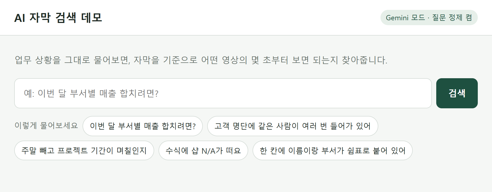
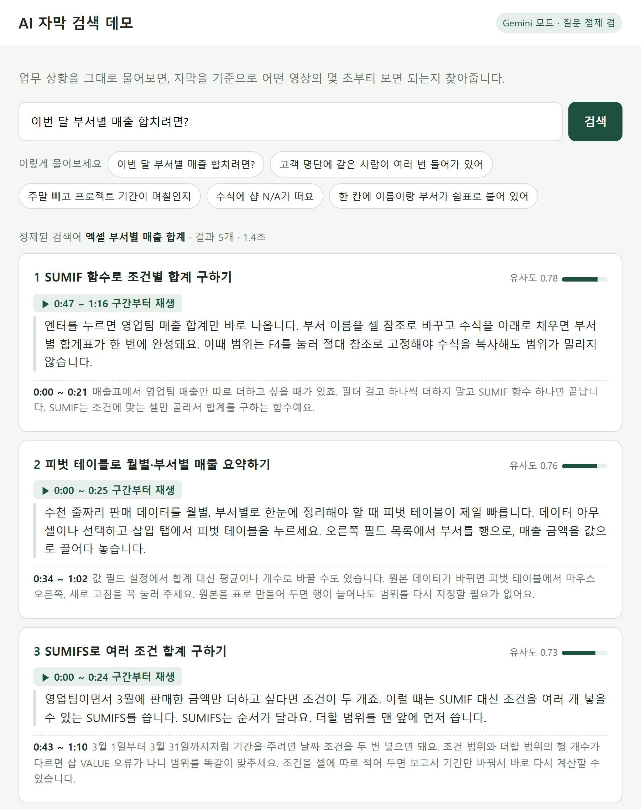
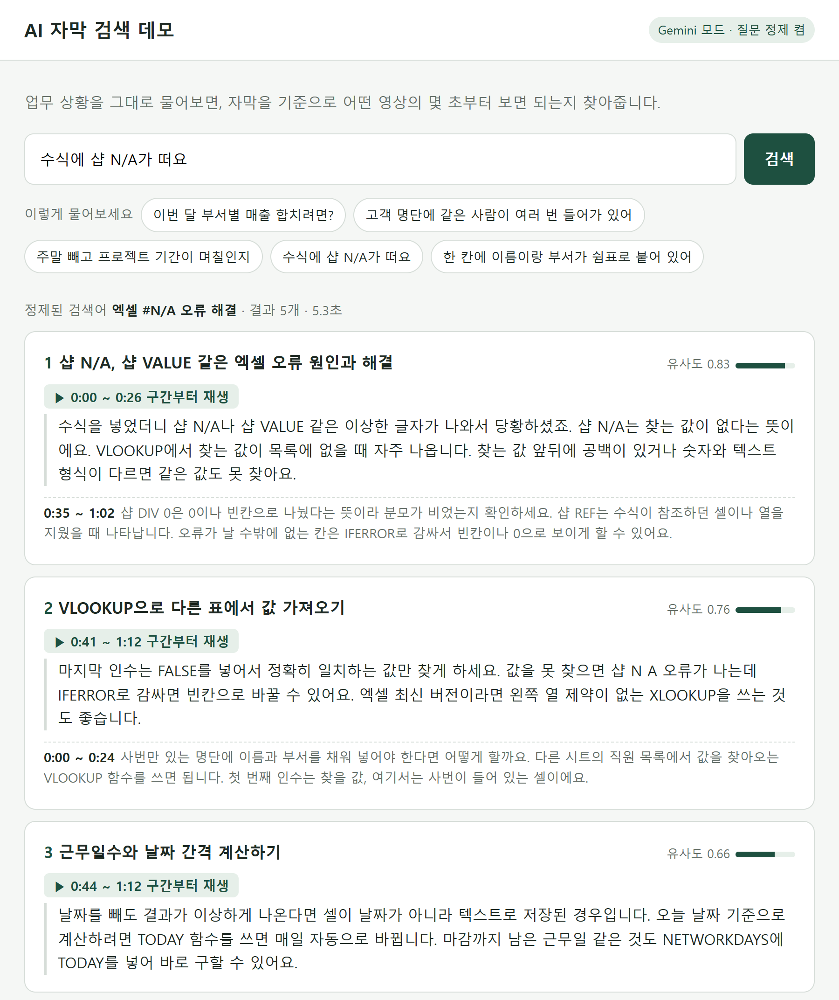
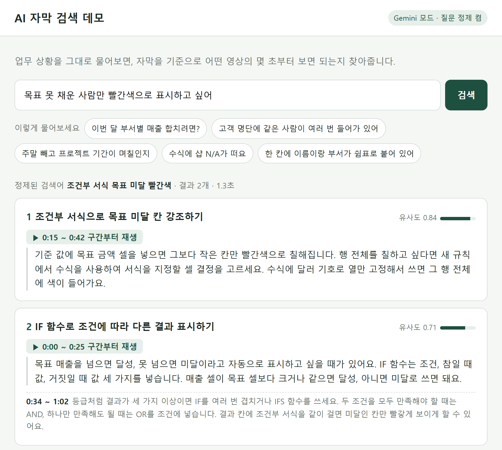
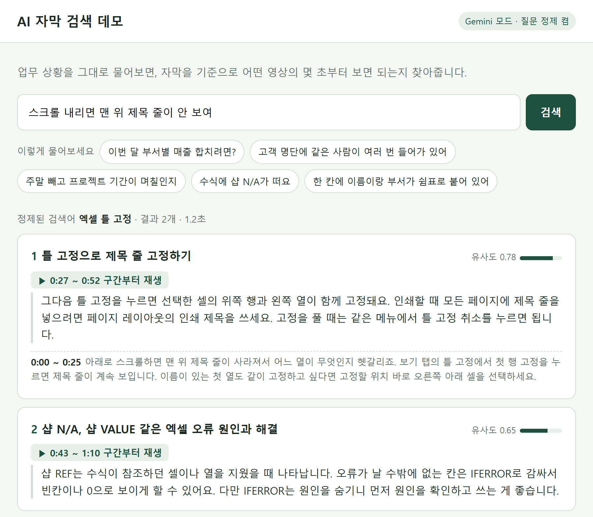
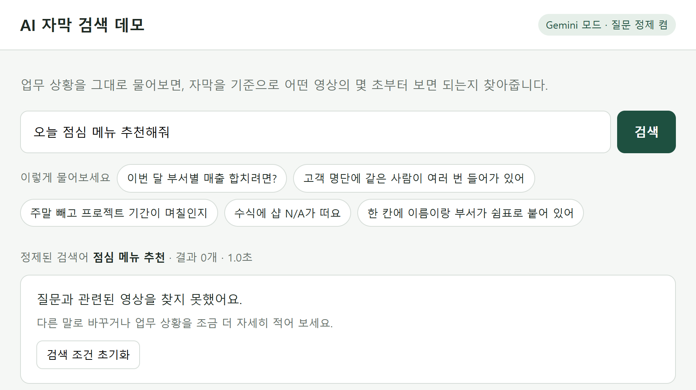

# 4주차 AI 검색 활동 내용

담당자: 임규혁
범위: `ai-search/` (AI 자막 검색 모듈)

사용자가 업무 상황을 그대로 질문하면, 영상 자막을 기준으로 어떤 숏폼의 몇 초부터 보면 되는지 찾아줍니다. 4주차에는 목업 데이터를 늘리고, 실제 Gemini API로 결과를 확인하는 데모 화면을 만들고, SRT·SMI 자막 파일을 처리하도록 했습니다.

## 1 4주차 과제·피드백 대응

| 과제·피드백 | 진행 결과 |
|---|---|
| 목업 데이터로 검색을 확인할 수 있도록 진행 | 엑셀 실무 샘플 영상을 3개에서 12개로 늘림. API 키 없이 동작하는 mock 모드로도 확인 가능 |
| API 연동이 안 되어도 AI API로 결과물이 나오도록 진행 | 실제 Gemini API(임베딩·질문 정제)로 검색하는 데모 화면 추가 |
| (기타 피드백) 자막을 SRT나 SMI 파일로도 처리 | SRT·SMI·VTT 자막 파일을 읽어 바로 검색 인덱스에 넣도록 구현 |

## 2 작업 내용

### 목업 자막 데이터 확장 (`data/subtitles.json`)

함수 이름을 몰라도 업무 상황이나 오류 메시지로 찾는 검색 차별점을 확인할 수 있도록, 업무 상황과 오류 메시지를 많이 담은 샘플 자막을 만들었습니다. SUMIF와 SUMIFS처럼 비슷한 주제도 일부러 넣어 의미 검색이 구분하는지 확인했습니다.

| 번호 | 샘플 영상 | 자막 형식 |
|---|---|---|
| 1~3 | SUMIF 조건별 합계, VLOOKUP 값 가져오기, 피벗 테이블 요약 (3주차) | JSON |
| 4~10 | SUMIFS 여러 조건 합계, COUNTIF 개수 세기, 중복 데이터 지우기, 텍스트 나누기, 근무일수 계산, IF 조건 표시, #N/A·#VALUE 오류 해결 | JSON |
| 11 | 조건부 서식으로 목표 미달 칸 강조하기 | SRT 파일 |
| 12 | 틀 고정으로 제목 줄 고정하기 | SMI 파일 (CP949) |

### 검색 데모 화면 (`demo/index.html`, `dev_server.py`)

백엔드 연동 전에도 실제 AI 검색 결과를 확인할 수 있도록 개발용 서버에 데모 화면을 추가했습니다. 백엔드에 붙일 검색 API(`POST /search`)는 바꾸지 않았습니다.

- 검색창과 예시 질문, 현재 모드(Gemini 또는 mock) 표시
- Gemini가 다듬은 검색어와 검색에 걸린 시간 표시
- 결과 카드: 영상 제목, 재생 시작 구간, 매칭된 자막, 유사도, 같은 영상의 다른 구간
- 관련 영상이 없으면 기획서 예외 처리 기준대로 '검색 조건 초기화' 안내

### SRT·SMI 자막 파일 처리 (`ai_search/subtitle_files.py`)

관리자가 올린 자막 파일을 그대로 검색에 쓸 수 있도록 만들었습니다. 자막 목록에 `subtitle_file`로 파일을 가리키거나, 명령 한 줄로 바로 인덱싱할 수 있고, 백엔드에서도 `read_subtitle_file`로 연결할 수 있습니다.

| 형식 | 처리 내용 |
|---|---|
| SRT | 번호 줄 무시, 여러 줄 자막 합치기, `<i>` 같은 꾸밈 태그 제거, 깨진 줄바꿈 처리 |
| SMI | 다음 SYNC 시작 시간을 끝 시간으로 사용, `&nbsp;`는 자막 지움, 한국어·영어가 함께 있으면 한국어(KRCC)만 사용, 언어별로 나뉜 SYNC 합치기 |
| VTT | DB 파일 종류에 있어 함께 지원. WEBVTT 헤더·NOTE·큐 설정 무시 |
| 인코딩 | UTF-8이 아니면 CP949로 읽기 |

### 검색 품질 평가 (`scripts/evaluate_search.py`)

함수 이름 없이 업무 상황으로 묻는 질문 24개와 관련 없는 질문 4개를 실제 Gemini로 검색해, 1위가 맞는지와 점수 분포를 확인하고 결과를 버리는 기준 점수를 정했습니다.

| 항목 | 결과 |
|---|---|
| 관련 질문 1위 정답 | 23 / 24 |
| SRT·SMI 자막 영상 질문 4개 | 4 / 4 |
| 관련 질문 1위 점수 | 0.702 ~ 0.830 |
| 관련 없는 질문 1위 점수 (점심 메뉴, 연차 신청 등) | 최고 0.612 → 결과 없음 |
| 기준 점수 `MIN_SCORE` | 0.65 유지 |

질문 정제를 켰을 때와 껐을 때도 비교했습니다(샘플 10개 기준). 정제를 켜면 1위 정답이 18/20에서 19/20으로 올라 기본값으로 켜 두었습니다.

## 3 결과 화면 (실제 Gemini 검색)

### 첫 화면

검색창과 예시 질문, 현재 모드(Gemini 모드 · 질문 정제 켬)를 보여줍니다.



### "이번 달 부서별 매출 합치려면?"

Gemini가 질문을 "엑셀 부서별 매출 합계"로 다듬고, SUMIF 영상의 해당 구간을 1위로 찾았습니다. (결과 5개 중 상위 3개까지 표시)



### "수식에 샵 N/A가 떠요"

오류 메시지로 검색해 오류 해결 영상을 1위, VLOOKUP 영상 속 #N/A 설명 구간을 2위로 찾았습니다. (결과 5개 중 상위 3개까지 표시)



### "목표 못 채운 사람만 빨간색으로 표시하고 싶어" (SRT 자막)

SRT 파일로 넣은 조건부 서식 영상을 1위로 찾았습니다.



### "스크롤 내리면 맨 위 제목 줄이 안 보여" (SMI 자막)

SMI 파일로 넣은 틀 고정 영상을 1위로 찾았습니다.



### "오늘 점심 메뉴 추천해줘"

관련 영상이 없으면 결과를 보여주지 않고 검색 조건 초기화를 안내합니다.



## 4 실행 방법

```powershell
# ai-search 폴더에서
.venv\Scripts\python -m scripts.index_subtitles      # 자막 인덱싱 (.env의 SEARCH_PROVIDER 모드)
.venv\Scripts\python -m uvicorn dev_server:app --port 8001
```

데모 화면: http://localhost:8001/ (인덱싱 후에는 서버를 다시 켜야 반영됩니다)

## 5 검증 결과와 남은 작업

| 검증 항목 | 결과 |
|---|---|
| 자동 테스트 (검색 로직 13개, 자막 파일 처리 8개) | 21개 통과, API 키 없이 실행 |
| GitHub에서 새로 받아 테스트·인덱싱 | 정상 동작 |

- 질문 정제 속도: Gemini 응답 시간이 날마다 크게 달라 검색 한 번에 1~15초가 걸렸습니다. 10초가 넘으면 원문으로 검색해 결과는 나오지만, 대기 시간을 줄일 방법을 찾을 예정입니다.
- 검색 정확도: 남은 오답 1개("영업팀이면서 3월 매출만 더하려면")는 정제 과정에서 SUMIFS 대신 SUMIF가 붙어 생겼습니다. 1위보다 점수가 많이 낮은 결과를 빼는 규칙도 검토할 예정입니다.
- 백엔드 연결: 검색 API를 백엔드에 붙이고, 비공개 영상 제외와 DB 자막(`subtitles` 테이블) 인덱싱을 연결할 예정입니다.
